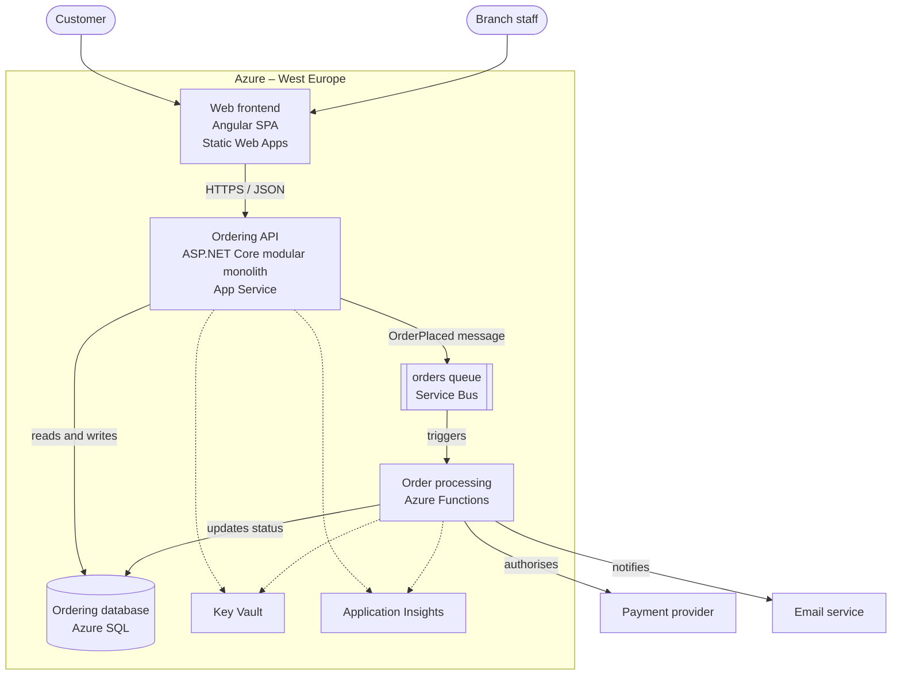

The deployable building blocks of Pizza Luna and the Azure services that host them (C4 level 2).

| Container | Technology | Responsibility |
| --- | --- | --- |
| Web frontend | Angular, Azure Static Web Apps | Customer shop and staff kitchen board in one SPA with role-based routes. |
| Ordering API | ASP.NET Core (.NET 10), Azure App Service | Modules `Menu`, `Branches` and `Ordering`; validates and stores orders, publishes `OrderPlaced`. |
| orders queue | Azure Service Bus (Standard) | Buffers placed orders so rush-hour peaks do not hit payment and email directly. |
| Order processing | Azure Functions (.NET 10 isolated) | Authorises payment, accepts or rejects the order, sends notifications. |
| Ordering database | Azure SQL Database | Menu, branches, orders; one database, one schema per module. |

Why the API is a modular monolith and why processing sits behind a queue is recorded in
[ADR-0003](../decisions/0003-use-a-modular-monolith-for-the-ordering-api.md) and
[ADR-0004](../decisions/0004-decouple-order-processing-with-service-bus.md).
