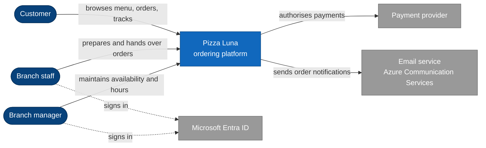

Pizza Luna as a black box: who uses it and which external systems it depends on (C4 level 1).

| Neighbour | Interaction |
| --- | --- |
| Customer | Orders as a guest; receives a tracking link by email. |
| Branch staff and managers | Sign in with Microsoft Entra ID; use the kitchen board and branch settings. |
| Payment provider | Authorises card payments; calls back with the payment result. |
| Email service | Sends order confirmations and status updates. |
