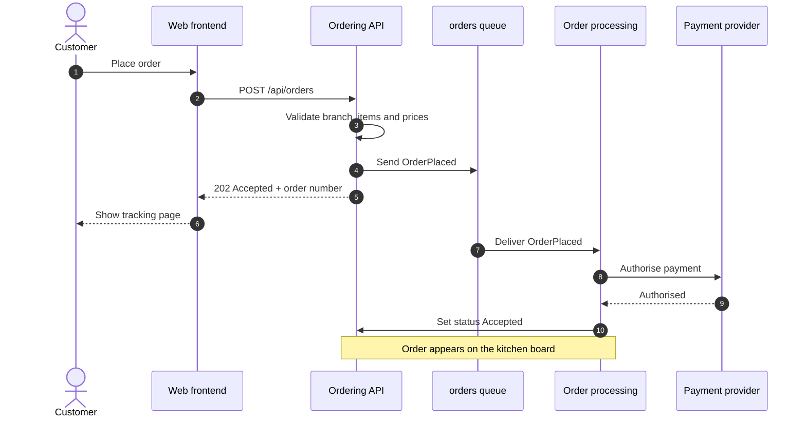

What happens between a customer pressing **Place order** and the order appearing on the kitchen
board.

## Notes

- The API answers with `202 Accepted` before payment is authorised. The customer sees status
  `Placed` until processing finishes, usually within a few seconds.
- If processing fails repeatedly, the message moves to the dead-letter queue; see the
  [dead-lettered orders runbook](../../operations/runbooks/dead-lettered-orders.md).
