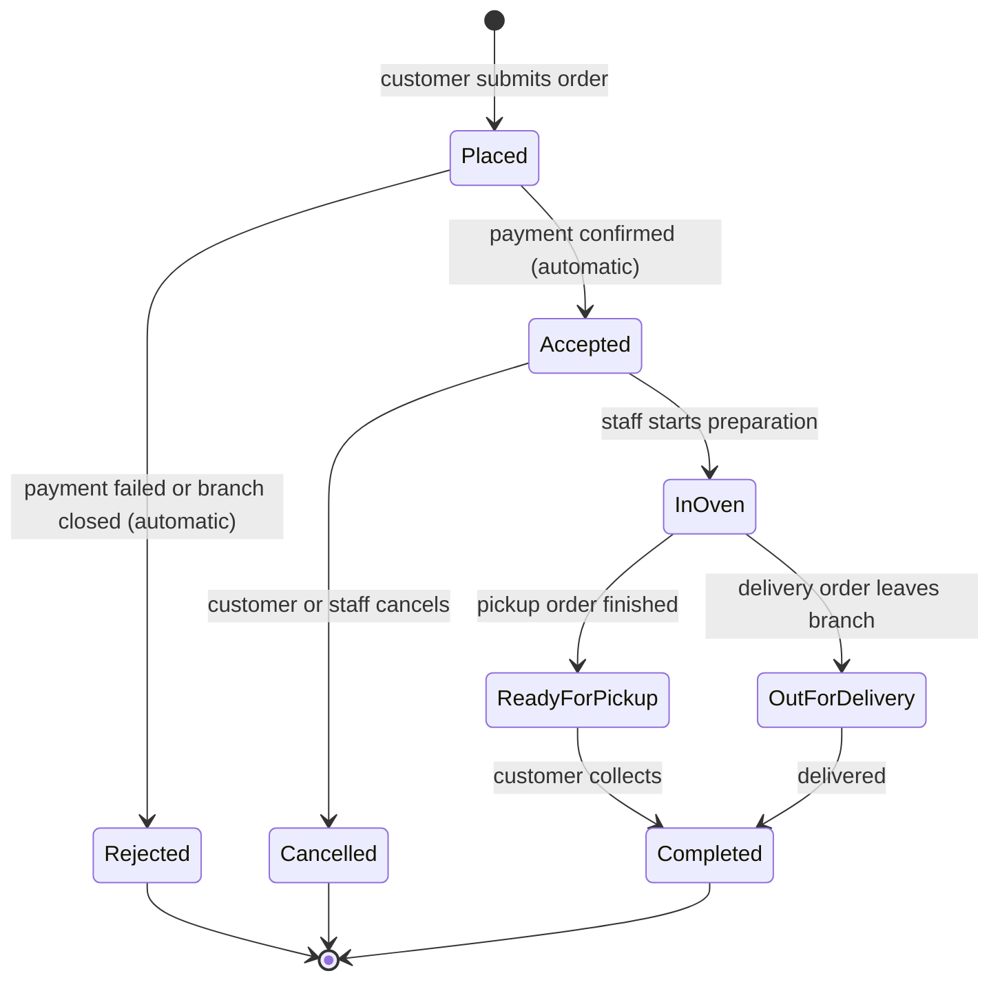

Every order moves through the same states. Branch staff move an order forward on the kitchen board;
the platform moves it automatically where noted.

## Rules

1. An order belongs to exactly one branch. The branch is chosen by the delivery address (delivery) or
   by the customer (pickup).
2. An order can only be placed while the branch is open and at least 30 minutes before closing time.
3. Customers can cancel an order until it reaches `InOven`. After that, only a branch manager can
   cancel, and the order is refunded manually.
4. The customer is notified by email on `Accepted`, `ReadyForPickup`, `OutForDelivery` and
   `Cancelled`.
5. An order that stays in `Placed` for more than five minutes is an operational problem; see the
   [order queue backlog runbook](../../operations/runbooks/order-queue-backlog.md).
