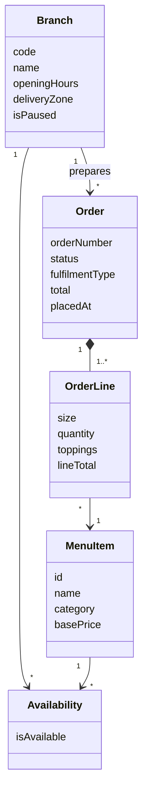

The core entities of the ordering domain. Names match the [glossary](../glossary.md) and the
API schema.

## Invariants

- An `Order` always has at least one `OrderLine`.
- An `OrderLine` can only reference a `MenuItem` that is available in the order's branch at the
  time the order is placed.
- `Order.total` is the sum of all line totals plus the delivery fee; see [Pricing](../business-rules/pricing.md).
